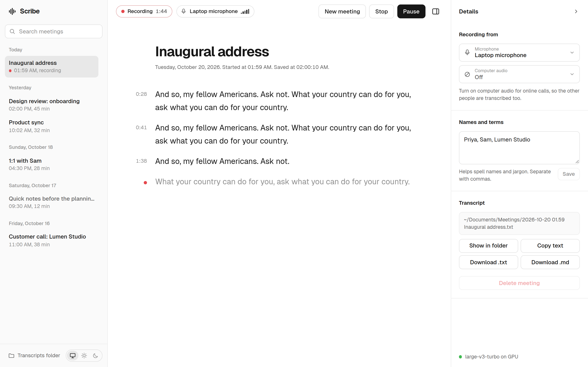
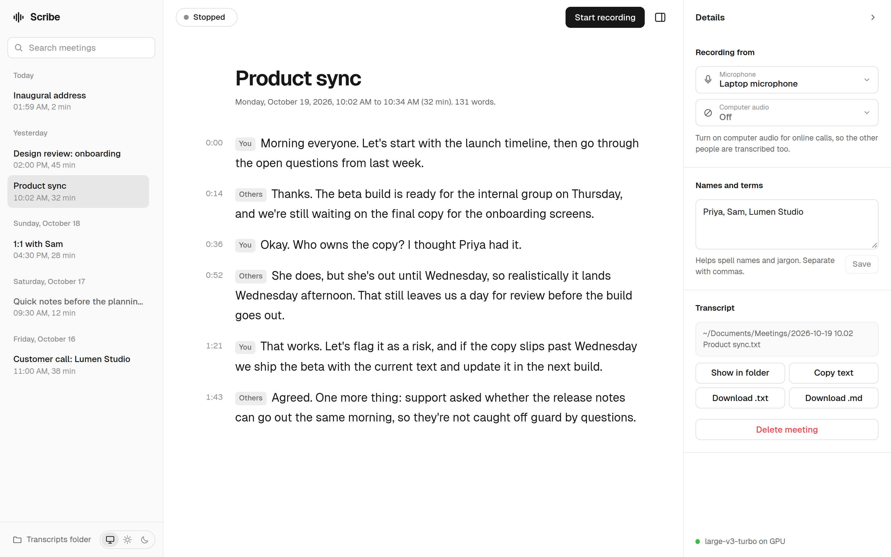

# Scribe

**Live meeting transcription that runs on your own computer.** Speech is
transcribed by OpenAI's Whisper model on your NVIDIA graphics card, so nothing
is uploaded and there's no account or API key. Each meeting is saved as one
text file that keeps itself up to date.

<picture>
  <source media="(prefers-color-scheme: dark)" srcset="docs/screenshots/recording-dark.webp">
  
</picture>

## Install

Scribe runs on Linux (Ubuntu, Linux Mint and similar) with an NVIDIA graphics
card.

1. **Graphics driver.** If it isn't installed yet, install the NVIDIA driver
   (Linux Mint: **Driver Manager**; Ubuntu: **Software & Updates → Additional
   Drivers**) and restart. Running `nvidia-smi` should then list your card.

2. **System packages.** Most are probably there already:

   ```bash
   sudo apt install git python3-venv pulseaudio-utils nodejs npm
   ```

3. **Scribe:**

   ```bash
   git clone https://github.com/alexmc2/scribe.git
   cd scribe
   ./install.sh
   ```

The installer checks steps 1 and 2 first and says exactly what's missing. It
then sets up Scribe's Python packages inside the folder (about 2.5 GB), builds
the interface, adds the `scribe` command, and downloads the speech model
(about 1.6 GB). Nothing is changed system-wide, and it's safe to run again.

Open a new terminal afterwards so the `scribe` command is found.

**To update** later: `git pull`, then `./install.sh` again.

## Use

```bash
scribe
```

Scribe loads the model (a few seconds), starts recording, and opens its
window: its own window if Chrome or Chromium is installed, otherwise a browser
tab at <http://127.0.0.1:8787>. The window is only reachable from your own
computer. Running `scribe` again while it's open brings the window back.

**Check it can hear you:** next to "Recording" at the top there's a chip for
each input, with level bars that move when you talk.

### Recording a call

Open **Details** (the panel button, top right) and set:

- **Microphone**: your voice. "System default" uses your system's input, and
  falls back to the built-in microphone if that isn't a microphone.
- **Computer audio**: what your computer plays, i.e. the other people on a
  Zoom, Teams or Meet call. Set it to "System default" for calls; leave it
  "Off" for meetings in a room.

With both on, each paragraph is labelled **You** or **Others**. Choices are
remembered.

### Past meetings

<picture>
  <source media="(prefers-color-scheme: dark)" srcset="docs/screenshots/meeting-dark.webp">
  
</picture>

- The sidebar lists every meeting by day and searches their text.
- Click any paragraph to correct it. Enter saves, Escape cancels, and clearing
  a paragraph removes it.
- **Pause / Resume** keeps the same meeting and file. **Stop** finishes it;
  **New meeting** finishes it and starts another.
- In **Details**: **Names and terms** helps spell names, acronyms and jargon.
  **Transcript** shows where the file is, and lets you copy it, download it as
  text or Markdown, or delete the meeting (it goes to the Trash).
- The switch at the bottom of the sidebar picks a light or dark look, or
  follows your system.

### In the terminal

The transcript also prints in the terminal. Keys: **p** pause/resume, **n**
new meeting, **s** stop, **q** quit. Scribe saves before it exits, including
when you close the terminal or press Ctrl+C.

### Options

```
scribe --title "Weekly sync"          title for the meeting that starts now
scribe --no-autostart                 wait for Start instead of recording at once
scribe --mic default|off|NAME         choose the microphone
scribe --computer-audio default|off|NAME
scribe --list-inputs                  show the device names you can use above
scribe --model distil-large-v3.5      another Whisper model (default large-v3-turbo)
scribe --language auto                detect the language (default English)
scribe --folder ~/somewhere/else      where transcripts are saved
scribe --open tab|none                browser tab instead of a window, or neither
scribe --no-web                       terminal only
```

## Where things are kept

| What | Where |
| --- | --- |
| Transcripts, one `.txt` per meeting | `~/Documents/Transcripts` |
| Scribe's copy of each meeting (for history and search) | `~/Documents/Transcripts/.scribe` |
| Settings | `~/.config/scribe/settings.json` |
| Log | `~/.local/state/scribe/scribe.log` |
| Speech model | `~/.cache/huggingface` |

A transcript file is rewritten every few seconds while there's new text, and
when you pause, stop, rename or quit. Saving replaces the file in one step, so
a crash can't leave half a transcript. A meeting where nobody spoke leaves no
file.

## Troubleshooting

- **Nothing appears when I talk.** Look at the microphone chip's level bars.
  If they don't move, choose your microphone in Details → Microphone (or run
  `scribe --list-inputs`).
- **Details says "on CPU".** The graphics card couldn't be used. Check
  `nvidia-smi` lists your card, then run `./install.sh` again.
- **`scribe` says its environment is broken.** This happens after a system
  upgrade replaces Python. Run `./install.sh` again.

## Uninstall

```bash
rm ~/.local/bin/scribe
rm -rf ~/.config/scribe ~/.local/state/scribe
```

Then delete the `scribe` folder. Transcripts in `~/Documents/Transcripts` are
left alone; delete them yourself if you want them gone.

## Developing

```
scribe/          Python: audio capture, transcription, saving, the local web server
scribe/web/      the page: index.html and css/ (dist/ is generated from frontend/)
frontend/src/    the page's TypeScript source
tests/           Python tests
```

The interface is TypeScript. Browsers only run JavaScript, so `install.sh`
compiles it into `scribe/web/dist/`, which isn't kept in git. After editing
`frontend/src/`:

```bash
cd frontend
npm run build          # or: npm run watch
```

Then reload the Scribe window (Ctrl+R). Python changes need Scribe restarted.

Checks:

```bash
.venv/bin/python -m unittest discover -s tests   # Python tests
ruff check scribe tests && ty check              # lint and types (settings in pyproject.toml)
(cd frontend && npm run check)                   # TypeScript types
```
